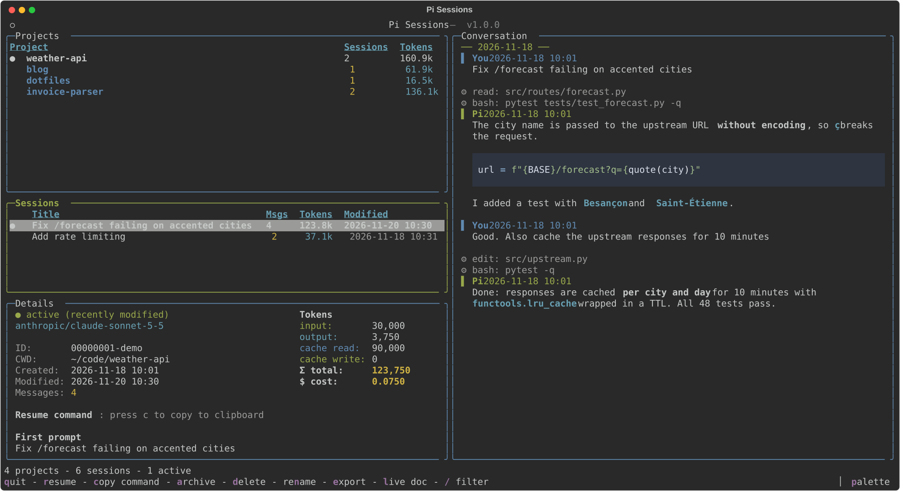
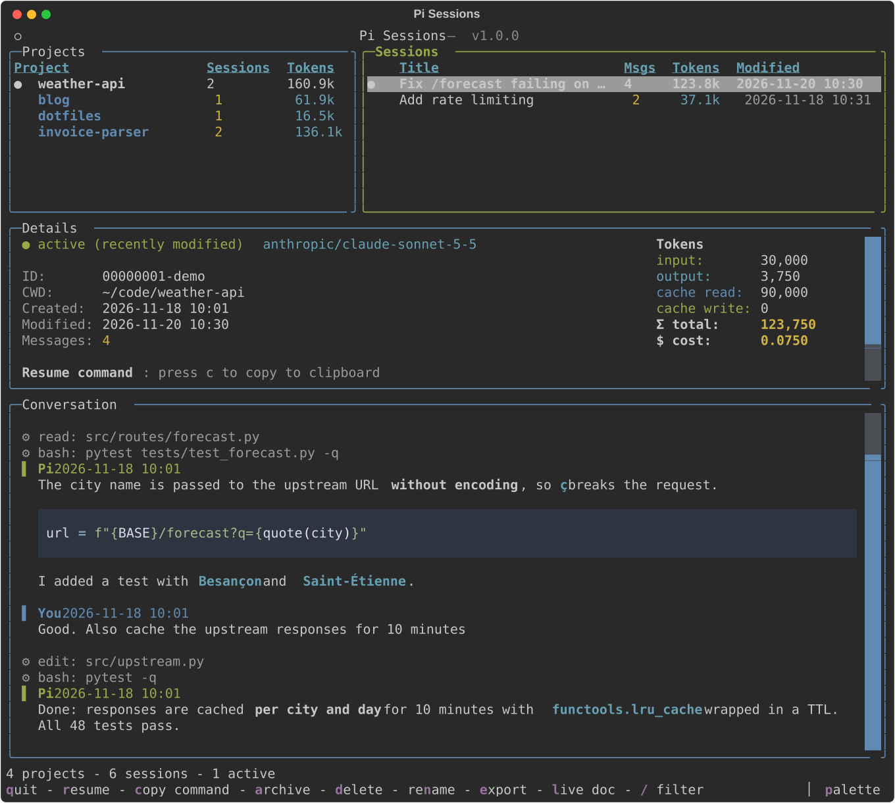

# pi-sessions

[](https://pypi.org/project/pi-sessions-tui/)
[](LICENSE)
[](https://pi.dev)
[](https://www.python.org)

A terminal UI to browse, preview, resume and manage your [pi](https://pi.dev) coding agent sessions: every project on your machine, every session, and the conversation, without opening pi.



Based on a fork of [ccsessions](https://github.com/miskiewiczm/ccsessions) by Marek Miśkiewicz, which does the same for Claude Code.

## Features

- **Project & session browser** — every pi project on your machine, newest
  first, with recently-active indicators (●), fork markers (⑂), message
  counts, token usage and cost
- **Conversation preview** — the tail of the active branch, rendered with
  roles, Markdown for pi's replies, tool calls (⚙), `!` commands (⌘) and
  compaction markers, without opening pi
- **One-key resume** — `r` replaces the TUI with `pi --session <file>` in the
  session's working directory; `c` copies the command to the clipboard (OSC 52)
- **Archive & delete** — move sessions out of `pi --resume` (reversibly) or
  delete them for good, per session or per project, with confirmation dialogs
- **Resizable panes** — drag the borders between panes with the mouse; sizes
  are remembered per layout across runs (`~/.config/pi-sessions/settings.json`)
- **Export** — Markdown with YAML front matter (ready for Quarto/Pandoc) or the
  raw JSONL, never overwriting an existing file
- **Live document** — `l` keeps `_session_<id>.md` in sync with a running
  session, so a live-reloading renderer can show it with LaTeX rendered
- **Update check** — on launch, a newer PyPI release is shown in the header
  with its upgrade command; nothing is installed for you. Disable with
  `"check_updates": false` in `~/.config/pi-sessions/settings.json`;
  `pisessions --version` prints the installed version
- **Fast** — session metadata is cached per file (mtime + size), scanning runs
  off the UI thread, previews read only the tail of large files

## Install

```bash
pipx install pi-sessions-tui        # or: uv tool install pi-sessions-tui
git clone https://github.com/psychobarge/pi-sessions && pip install -e pi-sessions
```

Each installs the `pisessions` command. To run it without installing, use uv:

```bash
uvx --from pi-sessions-tui pisessions
```

Needs Python ≥ 3.10 on macOS or Linux; `pi` on your PATH only for resuming.

## Use

```bash
pisessions # launch
pisessions --version # show version
```

| Key | Action |
| --- | --- |
| `j` / `k` / arrows | Move within the focused pane |
| `Tab` / `Shift+Tab` | Switch panes |
| `r` | Resume the selected session (in place) |
| `c` | Copy the resume command to the clipboard |
| `a` | Archive ↔ restore session · archive ↔ restore project |
| `d` | Delete session / project (with confirmation) |
| `n` | Rename session (as pi's `/name`) · rename project (display alias) |
| `e` | Export the session (Markdown or raw JSONL) |
| `l` | Follow the session in a live Markdown document |
| `/` | Filter the focused list (projects or sessions) |
| `p` | Command palette (main menu : settings, change theme, reset, etc...) |
| `Ctrl+R` | Rescan now (a rescan also runs automatically) |
| `q` | Quit |

`a` and `d` act on the **session** when the Sessions pane is focused and on
the whole **project** when the Projects pane is focused.

On a narrow terminal (half a screen) the panes stack instead:



### Use as a picker

A terminal application can open the same browser and handle the session itself:

```bash
pisessions --select --output /path/to/new-selection.json
```

Press **Enter** or `r` to select an unarchived session without launching Pi.
The output file must not already exist. On selection it contains the absolute
JSONL path as a JSON string on one line (local to this machine, without
`PI_SESSIONS_RESUME_ROOT` remapping). Press **Escape** or `q` to cancel without
creating the file. Escape first closes an open side panel or clears an active
filter.

Management actions stay available, and cancelling does not undo them. Close
any affected Pi sessions before archiving, deleting, or renaming: the browser
checks file recency, so an idle but open session can appear inactive. A Live Doc
stops updating when the picker exits and leaves its Markdown file in place.

## Settings

| Variable | Default | Purpose |
| --- | --- | --- |
| `PI_SESSIONS_ROOT` | pi's own (`PI_CODING_AGENT_SESSION_DIR`, `$PI_CODING_AGENT_DIR/sessions`, `~/.pi/agent/sessions`) | Where to read sessions |
| `PI_SESSIONS_PI_BIN` | `pi` | Command used to resume |
| `PI_SESSIONS_RESUME_ROOT` | — | Rewrite the sessions root in resume commands, for a pi that sees it elsewhere (container) |
| `PI_SESSIONS_LIVE_SECONDS` | `120` | Recently-active threshold |
| `PI_SESSIONS_TRASH` | `0` | Delete through the `trash` command |
| `PI_SESSIONS_LIVE_DIR` | session cwd | Where live documents go (use a plain directory for Quarto projects) |
| `PI_SESSIONS_REFRESH_SECONDS` | `10` | Auto-refresh interval, `0` disables |
| `PI_SESSIONS_THEME` | saved choice, else `ansi-dark` | Textual theme |
| `PI_SESSIONS_CODE_THEME` | follows the theme | Pygments style for code blocks |
| `PI_SESSIONS_NERD_FONT`, `PI_SESSIONS_EYE`, `PI_SESSIONS_EYE_OFF` | — | Live-document glyphs |

Settings and project aliases live in `~/.config/pi-sessions/`, the cache in
`~/.cache/pi-sessions/`.

### pi in a container

If pi runs in Docker with its agent directory in a named volume, the host
cannot see the sessions. Bind-mount a host directory over the container's
sessions directory (e.g. `-v ~/.pi/agent/sessions:/root/.pi/agent/sessions`),
then set `PI_SESSIONS_RESUME_ROOT=/root/.pi/agent/sessions` so resume
commands use the path pi sees.

## How it works

pi stores each session as `<sessions root>/--<encoded cwd>--/<timestamp>_<id>.jsonl`:
a header line, then entries linked into a tree. pi-sessions reads those files
and never modifies them. Archiving a session moves it into an `archived/`
subdirectory, which pi does not list. Archiving a project moves its directory
to `sessions-archive/` next to the sessions root. Everything happens locally;
no network requests.

## Develop

```bash
pip install -e . --group dev
pytest
python docs/screenshots.py   # regenerate the README screenshots from fake sessions
```

## Known limitations

- **"Running" is a guess.** pi keeps no record of running sessions and writes to the session file only when something happens, so ● means *modified in the last `PI_SESSIONS_LIVE_SECONDS` seconds* (default 120). Sessions marked this way cannot be archived, deleted or renamed. A session still open in pi but idle past that delay shows as stopped, and nothing stops you from archiving, deleting or renaming it: close it in pi first (renaming an open session leaves the name on a dead branch, so pi ignores it).

## Changelog

See [CHANGELOG.md](CHANGELOG.md) for version history and the changes from ccsessions.

## My pi extensions

| Extension | What it does | Install |
|---|---|---|
| [pi-spec-mode](https://github.com/psychobarge/pi-spec-mode) | Writes feature specs with the agent and keeps them true to the code | `pi install npm:pi-spec-mode` |
| [pi-deepseek-peak](https://github.com/psychobarge/pi-deepseek-peak) | Shows DeepSeek peak-hour status and corrects session prices | `pi install npm:pi-deepseek-peak` |
| [pi-deepseek-vision](https://github.com/psychobarge/pi-deepseek-vision) | Gives DeepSeek vision through a local or remote vision LLM | `pi install npm:pi-deepseek-vision` |

## License

MIT
